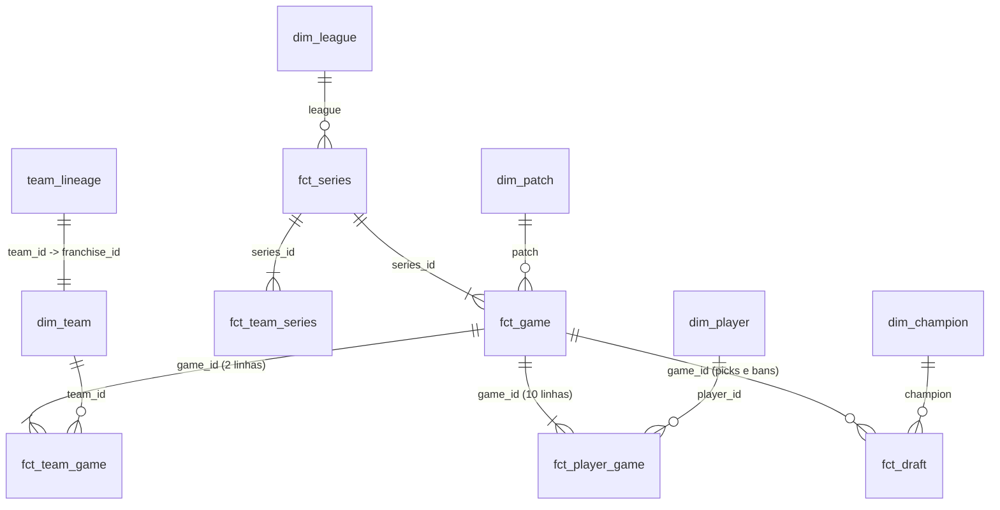

# Modelo de dados

Este documento descreve o banco analítico `data/lol.duckdb`, construído com `lolpred build-db`
a partir dos Parquet coletados. O banco é **100% derivado**: pode ser apagado e recriado a
qualquer momento (leva menos de um minuto) e nunca é editado à mão.

## Por que em camadas

Cada camada tem um papel só, e cada uma lê apenas a anterior. Se uma fonte mudar de formato,
o conserto fica em um lugar (a staging) e o resto continua igual.

| Camada | Para que serve | Exemplos |
|---|---|---|
| `raw` | Os dados como vieram da fonte (views sobre os Parquet) | `raw.oe_matches`, `raw.dd_champions` |
| `stg` | Limpeza: tipos, nomes de colunas, patch padronizado, chaves preenchidas | `stg.oe_team_games`, `stg.oe_player_games` |
| `core` | O modelo de dados: **dimensões** (quem/o quê) e **fatos** (o que aconteceu) | `core.fct_series`, `core.dim_team` |
| `feat` | Variáveis **pré-partida**, sem vazamento | `feat.series_team`, `feat.team_elo` |
| `mart` | Tabelas prontas para análise e modelagem | `mart.pregame_series`, `mart.champion_patch_meta` |

## Diagrama do core



## Tabelas do core

A **granularidade** (o que é uma linha) é a informação mais importante de cada tabela.

| Tabela | Uma linha é... | Chave | Observações |
|---|---|---|---|
| `fct_series` | uma série (Bo1, Bo3, Bo5) | `series_id` | `team1` = lado azul do jogo 1. `best_of` inferido pelo placar. `is_clean` = série completa e sem jogos sem resultado. |
| `fct_game` | um jogo (mapa) | `game_id` | `series_game_seq` = ordem do jogo na série. `blue_win` = alvo por mapa. |
| `fct_team_series` | uma série x um time | `series_id, team_id` | A mesma série vista de cada lado; facilita tudo que é "por time". |
| `fct_team_game` | um jogo x um time | `game_id, team_id` | Todas as estatísticas do time no jogo + escalação (`top_player_id`... e a lista `players`). |
| `fct_player_game` | um jogo x um jogador | `game_id, player_id` | Estatísticas do jogador, campeão e o adversário de rota (`lane_opp_player_id`). |
| `fct_draft` | uma ação do draft | `game_id, team_id, action, action_number` | Picks e bans em formato longo. `win` preenchido nos picks. |
| `dim_team` | um ID de time | `team_id` | Inclui `franchise_id`/`franchise_name`. |
| `team_lineage` | um ID de time | `team_id` | Liga IDs que são a mesma organização (ver abaixo). |
| `dim_player` | um jogador | `player_id` | `main_role` = posição mais jogada; `last_team_*` = time mais recente. |
| `dim_league` | uma liga | `league` | `tier`: 1 internacional, 2 liga principal, 3 segunda divisão/regional, 4 outras. Editável em `src/lolpred/seeds/leagues.csv`. |
| `dim_patch` | um patch | `patch` | `patch_order` (ex.: 1610) ordena corretamente; `prev_patch`. |
| `dim_champion` | um campeão | `champion` | Classe, recurso e notas do Data Dragon na versão mais recente. Por patch: `raw.dd_champions`. |

### Como as séries são reconstruídas

A fonte não tem ID de série. Jogos da mesma liga entre o mesmo par de times pertencem à
mesma série enquanto o número do jogo cresce (1, 2, 3...) e não passam mais de 18 h entre
um jogo e outro. Resultado: 60 mil séries, 98% delas "limpas". As demais são, em geral,
formatos Bo2 (placar 1-1) ou séries com algum jogo faltando na fonte.

### Linhagem de times (`franchise_id`)

O Oracle's Elixir cria um ID novo quando uma organização muda de nome. Sem tratar isso, o
histórico do time "zeraria" na troca. A linhagem liga o time B ao time A quando B estreia até
180 dias depois do último jogo de A e os dois compartilham pelo menos 3 jogadores (ou 2, se for
a mesma liga e um nome contiver o outro). Exemplos que ela encontra sozinha:
SK Telecom T1 → T1, Samsung Galaxy → KSV → Gen.G, Gamers2 → G2 Esports.

Todo o histórico de **time** na camada `feat` segue a franquia. O de **jogador** segue o
`player_id`, que já é estável na fonte. Correções manuais vão em
`src/lolpred/seeds/team_lineage_overrides.csv`.

## Variáveis pré-partida (sem vazamento)

### O problema

Para prever uma partida, só vale usar o que se sabia **antes de ela começar**. Usar, sem
querer, informação do próprio jogo ou de jogos posteriores é o erro mais comum nesse tipo de
projeto e produz modelos que parecem ótimos e não funcionam na prática.

### A solução, em dois passos

1. **Tabelas de estado** (`feat.team_game_state`, `feat.player_game_state`, ...) registram como
   cada time/jogador estava logo **depois** de cada jogo: taxa de vitória nos últimos 10 jogos,
   média de diferença de ouro aos 15 min nos últimos 10, e assim por diante. Cada linha só
   enxerga o passado, porque as janelas olham apenas para trás.
2. Para uma série que começa no instante *T*, o **ASOF JOIN** pega, para cada time, o **último
   estado com horário anterior a *T***. Nenhum jogo da própria série entra, nem o jogo 1 nas
   variáveis do jogo 2.

`lolpred check-db` recalcula algumas variáveis "na mão" (contando diretamente os jogos
anteriores) e confere se batem com as da camada `feat`. Roda no CI a cada coleta.

### Escalação

As variáveis de jogador usam a escalação do **jogo 1** da série. As escalações são anunciadas
antes da partida e do draft, então continuam sendo informação pré-partida. Se o objetivo for
prever sem saber quem joga, use só as variáveis de time (as que não começam com `lineup_` nem
com o nome de uma posição).

### Dicionário (`feat.series_team`, uma linha por série x time)

Nas tabelas `mart`, cada variável aparece três vezes: `t1_*` e `t2_*` (ou `blue_*` e `red_*`)
e `diff_*` (time 1 menos time 2).

| Grupo | Variáveis | Significado |
|---|---|---|
| Rating | `elo_pre` | Elo da franquia antes do 1º jogo da série (ver `src/lolpred/warehouse/elo.py`). |
| Volume | `games_total`, `series_total`, `split_games` | Jogos e séries disputados antes; jogos no split atual. |
| Forma (jogos) | `winrate_total`, `winrate_last10`, `winrate_last20`, `split_winrate` | Taxa de vitória: histórica, nos últimos 10/20 jogos, no split atual. |
| Forma (séries) | `series_winrate_total`, `series_winrate_last10`, `map_winrate_in_series_last10`, `bo3plus_winrate_last10` | Desempenho em séries; o último considera só Bo3/Bo5. |
| Início de jogo | `gold_diff_10_last10`, `gold_diff_15_last10`, `xp_diff_15_last10`, `cs_diff_15_last10`, `gold_diff_15_obs_last10` | Vantagem média aos 10/15 min nos últimos 10 jogos. `_obs_` = quantos desses jogos tinham o dado (ver limitações). |
| Objetivos | `first_blood_rate_last20`, `first_dragon_rate_last20`, `first_herald_rate_last20`, `first_tower_rate_last20`, `first_baron_rate_last20`, `dragon_diff_last20`, `baron_diff_last20`, `tower_diff_last20` | Frequência de primeiros objetivos e saldo médio de objetivos. |
| Estilo | `kill_diff_last20`, `combined_kpm_last20`, `game_minutes_last20`, `earned_gpm_last20`, `dpm_last20`, `vspm_last20`, `wcpm_last20` | Saldo de abates, ritmo (abates/min dos dois times), duração, ouro, dano e visão. |
| Contexto | `days_since_last_game`, `league_changed`, `playoff_series_total`, `playoff_share_total` | Descanso; se o último jogo foi em outra liga (ex.: chegando a um internacional); experiência em playoffs. |
| Confronto direto | `h2h_series`, `h2h_series_winrate`, `h2h_map_winrate` | Histórico contra este adversário. |
| Escalação | `lineup_continuity` | Quantos dos 5 titulares jogaram o último jogo do time (0 a 5). |
| Escalação | `lineup_games_mean`, `lineup_games_min`, `lineup_rookies`, `lineup_games_with_team_mean`, `lineup_new_to_team` | Experiência dos jogadores na carreira e no time; novatos (< 20 jogos); recém-chegados. |
| Escalação | `lineup_winrate_last20_mean`, `lineup_kda_last20_mean`, `lineup_gold_diff_15_last20_mean`, `lineup_champion_pool_mean` | Forma individual média e tamanho do repertório de campeões (últimos 30 jogos). |
| Por posição | `top_/jng_/mid_/bot_/sup_gold_diff_15_last20`, `top_/.../sup_kda_last20` | Forma individual de cada posição. |
| Meta | `lineup_meta_fit_mean`, `lineup_meta_top10_mean` | Quanto os campeões que os jogadores vinham jogando estão em alta no meta (ver abaixo). |

### Variáveis de meta

O meta de um patch só é conhecido depois que ele é jogado. Por isso a série usa o meta do
**patch de referência**: o patch anterior com pelo menos 100 jogos, que já estava encerrado
quando a série começou. Para cada jogador:

- `meta_fit` = popularidade média, na posição dele, dos campeões que ele jogou nos últimos
  30 jogos. Se ele vinha jogando só campeões muito escolhidos no patch de referência, o valor é alto.
- `meta_top10_in_pool` = quantos campeões do top 10 da posição estão no repertório recente dele.

A tabela vira `lineup_meta_fit_mean` e `lineup_meta_top10_mean` (média dos 5 titulares).

## Tabelas mart

| Tabela | Uma linha é... | Alvo | Uso |
|---|---|---|---|
| `mart.pregame_series` | uma série | `team1_win` | Prever quem vence a série. |
| `mart.pregame_games` | um mapa | `blue_win` | Prever cada mapa. Inclui o placar da série antes do mapa (`*_series_wins_before`), que é conhecido antes de o mapa começar. |
| `mart.champion_patch_meta` | campeão x patch x escopo | | Pick rate, ban rate, presença e taxa de vitória. Escopo `todas` ou `tier1-2`. |
| `mart.team_champion_patch` | franquia x patch x campeão x posição | | Quais campeões cada time jogou em cada patch e quanto venceu com eles. |
| `mart.team_split_summary` | franquia x split | | Resumo de desempenho por split. |

## Exemplos de consulta

```python
import duckdb
con = duckdb.connect("data/lol.duckdb", read_only=True)

# Base de modelagem: séries limpas de ligas principais e internacionais desde 2018
df = con.sql("""
    SELECT * FROM mart.pregame_series
    WHERE is_clean AND league_tier <= 2 AND season >= 2018
""").df()

# Meta: os campeões mais presentes nos últimos patches (ligas tier 1-2)
con.sql("""
    SELECT patch, champion, round(presence, 2) AS presenca, round(winrate, 3) AS vitoria
    FROM mart.champion_patch_meta
    WHERE scope = 'tier1-2' AND patch_order >= 1620
    QUALIFY row_number() OVER (PARTITION BY patch ORDER BY presence DESC) <= 5
    ORDER BY patch_order DESC, presence DESC
""").df()

# "Times que rendem mais quando certos campeões estão no meta":
# taxa de vitória de cada time com cada campeão x presença do campeão no patch
con.sql("""
    SELECT t.franchise_name, t.patch, t.champion, t.picks, round(t.winrate, 2) AS vitoria_time,
           round(m.presence, 2) AS presenca_meta
    FROM mart.team_champion_patch t
    JOIN mart.champion_patch_meta m
      ON m.scope = 'todas' AND m.patch_order = t.patch_order AND m.champion = t.champion
    WHERE t.franchise_name = 'T1' AND t.picks >= 3
    ORDER BY t.patch_order DESC, t.picks DESC
""").df()
```

## Como adicionar uma variável

1. Se ela vem de uma média móvel por jogo, acrescente a coluna em `feat.team_game_state` (time)
   ou `feat.player_game_state` (jogador) em `src/lolpred/sql/30_feat.sql`. A janela já olha
   só para trás.
2. Se for agregada da escalação, inclua em `feat.lineup_form`.
3. Pronto: `feat.series_team` a recebe, e as tabelas `mart` ganham `t1_`/`t2_`/`diff_`
   automaticamente.
4. Rode `pytest` e `lolpred check-db`.

## Limitações conhecidas

- **Dados parciais**: cerca de 60% dos jogos de LPL e LDL vêm sem estatísticas detalhadas
  (`completeness = 'partial'`): faltam diferença de ouro, primeiros objetivos etc. As médias
  ignoram jogos sem o dado, e a coluna `gold_diff_15_obs_last10` diz quantos jogos sustentam a média.
- **Elo entre regiões**: ligas que quase não se enfrentam (ex.: ERLs europeias e LCK) têm
  ratings que só se calibram em torneios internacionais. Um 1800 numa ERL não equivale a um
  1800 na LCK. Para comparações entre regiões, combine com `league_tier`.
- **Linhagem**: é uma heurística. Revise casos de interesse em `core.team_lineage` e corrija
  em `seeds/team_lineage_overrides.csv`.
- **Fonte única**: o core usa só o Oracle's Elixir por enquanto. Leaguepedia e lolesports
  (calendário futuro, nomes alternativos de times) entram numa próxima etapa, quando a carga
  histórica dessas fontes terminar. É o que vai permitir prever séries que ainda não aconteceram.
- **12 jogos** em que a fonte registra o mesmo time nos dois lados foram excluídos.
